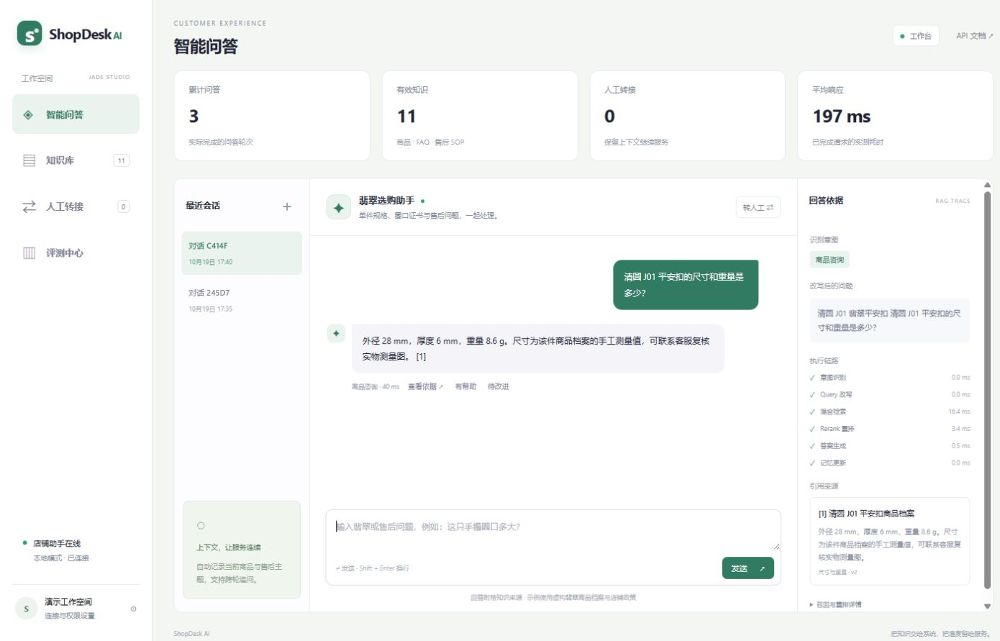
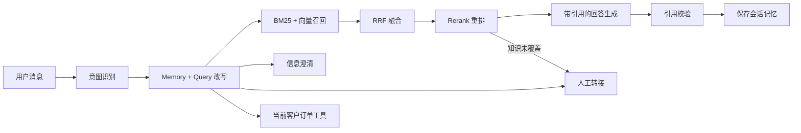

<div align="center">

# ShopDesk AI · 翡翠智能客服

### 单件商品有档案，多轮咨询有记忆，每个回答有来源。

**LangChain · LangGraph · Hybrid RAG · BM25 · Qdrant · Rerank · LangSmith**

</div>

ShopDesk 是面向翡翠店铺的智能客服平台，覆盖平安扣、手镯、山水牌的规格咨询、圈口信息、证书核对流程、物流及退换货。它将知识库管理、流式问答、检索证据、人工转接与评测放在同一个工作台中。

从“这只手镯圈口多大”到“那它拆封后还能退吗”，系统保留当前单件商品与售后主题，改写出完整检索问题，再将可核对的商品档案与店铺政策交给生成节点。需要看实物、核对真伪、确认个体圈口适配或处理交易争议时，工单带上上下文交给人工。

[运行项目](#快速运行) · [技术链路](#rag-链路) · [工作台功能](#工作台功能) · [PRD](docs/PRD.md) · [架构设计](docs/architecture.md) · [Benchmark](docs/evaluation.md)

## 项目预览



工作台内有可点击的问答示例。商品为项目构造的翡翠档案：清圆 J01 平安扣、清和 B02 手镯、观山 P03 山水牌，配套示例政策、订单与证书编号。

## 快速运行

Python 3.11+，从仓库根目录执行：

```powershell
python -m venv .venv
.\.venv\Scripts\Activate.ps1
python -m pip install -e ".[dev]"
python -m shopdesk serve
```

打开 [http://127.0.0.1:8010](http://127.0.0.1:8010)，即可体验问答、知识管理、人工工单与评测。Linux/macOS 使用 `source .venv/bin/activate` 激活环境。

默认本地模式使用字符 n-gram Embedding、特征 Rerank 和抽取式回答，自动构建 Qdrant 索引。工作台本地管理口令为 `local-demo-admin`，可在左下角的连接设置修改本次浏览器连接口令；服务端口令通过环境变量配置。

命令行入口：

```powershell
python -m shopdesk ingest
python -m shopdesk demo --message "清圆 J01 平安扣的尺寸和重量是多少？"
python -m shopdesk evaluate --report outputs/benchmark.json
```

## 工作台功能

| 功能 | 交互与数据流 |
|---|---|
| 智能问答 | SSE 推送节点进度，回答带引用；右侧展示意图、改写、召回、重排和节点耗时 |
| 多轮会话 | 记录当前翡翠编号、售后主题、订单实体与近期对话；会话可再次打开 |
| 知识管理 | 新增、编辑、启停、删除商品详情、FAQ 和 SOP；版本变化触发索引同步 |
| 人工转接 | 客户主动请求、投诉、看货与实物核对进入工单；保留商品和对话摘要 |
| 工单处理 | 待接入 → 处理中 → 已解决；记录处理人与解决说明 |
| 客户反馈 | 回答支持有帮助 / 待改进，负向反馈进入 Bad Case 列表 |
| 评测中心 | 运行内置场景集，对照基础检索链路，生成事实命中、召回、路由与延迟报告 |

## RAG 链路



LangGraph 将意图、改写、检索、重排、生成、订单查询和转接组织为显式节点。LangChain 提供消息、结构化输出、Embedding 与工具接口。问答请求使用唯一 `request_id`，重复请求复用已完成结果，避免重复写入消息和工单。

### 针对内容设计 Chunk

| 内容 | 切分方式 | 保留的信息 |
|---|---|---|
| 单件商品档案 | 标题分段、相邻句向量相似度分组，超长内容滑动窗口切分 | 商品编号、规格主题、完整父段落 |
| FAQ | Q/A 对作为基本单元，超长问答再滑窗 | 问题、回答与适用范围 |
| 售后 SOP | 标题与步骤拆分，附加父段上下文 | 流程主题、操作步骤与触发条件 |

默认子块窗口 380 字符、Overlap 60；检索小块，回答时补回对应父段落。每个块保留文档 ID、版本、标题、商品范围、来源摘要和策略。`ingest --strategy window` 可切换统一窗口基线。

相邻句分组使用当前配置的 Embedding：本地字符特征用于可复现演示，语义 Embedding API 用于实际语义向量分组。向量缓存以模型指纹和文本摘要为键。

### 混合召回与 Rerank

- **BM25**：jieba 分词后进行领域词项检索，保留型号、圈口、尺寸、证书和售后词汇。
- **向量检索**：Qdrant Local 持久化；配置 Qdrant Server 地址后切换共享服务。
- **融合**：RRF 合并两路排名，并按当前商品过滤其他单件档案。
- **重排**：本地后端综合问题覆盖、标题、内容类型、商品实体和主题匹配；可切换 HTTP Rerank 或 CrossEncoder。
- **生成**：本地模式从父段落选择相关语句；LLM 模式使用结构化 AnswerDraft，提交实际来源 ID。

## Memory 与 Prompt

会话记忆由商品 ID、当前意图、已核对订单和近期用户诉求摘要组成，SQLite 保存原始对话。Query 改写节点将“它”“这只”“那运费呢”等追问与当前上下文连接，切换商品时更新实体。

提示词分为 [Query 改写](src/shopdesk/assets/prompts/rewrite.md) 与 [回答生成](src/shopdesk/assets/prompts/answer.md)。翡翠场景按单件编号读取尺寸、重量、价格和档案；圈口内径与个人佩戴适配分别处理，具体实物核对进入人工工单。

## 连接真实模型

复制 `.env.example` 为 `.env`，填写模型与向量服务：

```dotenv
SHOPDESK_MODE=llm
OPENAI_API_KEY=你的密钥
OPENAI_BASE_URL=你的OpenAI兼容端点
CHAT_MODEL=支持结构化输出的模型ID

EMBEDDING_BACKEND=openai
EMBEDDING_API_KEY=你的Embedding密钥
EMBEDDING_BASE_URL=你的Embedding端点
EMBEDDING_MODEL=text-embedding-3-small

RERANK_BACKEND=http
RERANK_URL=你的Rerank接口地址
RERANK_API_KEY=你的Rerank密钥
RERANK_MODEL=你的Rerank模型ID
```

HTTP Rerank 使用 `query / documents / top_n` 请求与 `results[index,relevance_score]` 响应。CrossEncoder 后端通过 `pip install -e ".[cross-encoder]"` 安装，配置详见 [部署文档](docs/deployment.md)。

启用 LangSmith：

```dotenv
LANGSMITH_TRACING=true
LANGSMITH_API_KEY=你的LangSmith密钥
LANGSMITH_PROJECT=shopdesk-ai
```

图执行携带 `session_id` 和 `request_id`，知识入库、混合检索和 Rerank 使用独立 trace span，便于定位问题与比较 Prompt 版本。

## Benchmark 与 Bad Case

内置翡翠场景集包含 **32 个测试轮次**，覆盖规格、圈口、证书流程、清洁、售后、运费、多轮指代、商品切换和人工转接。指标由 `evaluate` 命令现场计算，机器可读报告随示例交付。

```powershell
python -m pytest -q
python -m shopdesk evaluate --report outputs/benchmark.json
```

评估同时报告完整链路的答案事实命中、意图、实体、路由、Recall@3 和链路处理 P50/P95；基线报告原始 Query＋统一窗口＋混合检索的上下文事实覆盖与检索耗时。两类延迟分别统计。

Bad Case 按 `answer_fact_missing`、`retrieval_miss`、`intent_mismatch`、`route_mismatch` 分类；客户负向反馈也可从工作台进入复盘。数据集、计算口径和实测结果见 [评估文档](docs/evaluation.md)。

## 产品交付

- [PRD](docs/PRD.md)：目标用户、场景、功能优先级、状态流转与验收标准。
- [交互与原型说明](docs/prototype.md)：信息架构、主要页面与关键状态。
- [架构设计](docs/architecture.md)：存储、索引生命周期、Memory、Rerank 与请求幂等。
- [Bad Case 复盘](docs/bad-cases.md)：问题、归因、修正与回归用例。
- [部署与 API](docs/deployment.md)：本地运行、模型配置、容器与接口约定。
- [项目展示与简历表述](docs/showcase.md)：演示顺序与可核实的项目描述。

## 代码结构

```text
src/shopdesk/
├── graph.py            LangGraph 问答路由
├── planning.py         意图与上下文改写
├── retrieval.py        BM25 / Qdrant / RRF
├── chunking.py         商品、FAQ、SOP 自适应分块
├── rerank.py           本地 / HTTP / CrossEncoder 重排
├── generation.py       抽取式 / LLM 回答与引用校验
├── service.py          REST / SSE / CLI 共用执行边界
├── store.py            知识、会话、工单与反馈
├── tools.py            当前客户的只读订单工具
├── api.py / cli.py     服务与命令行入口
└── assets/             翡翠知识、Prompt、评测集和前端
```

工作台静态资源与知识一起打入 wheel。GitHub Actions 执行 Python 测试、代码检查、Benchmark 和构建，便于在新环境复现项目。
